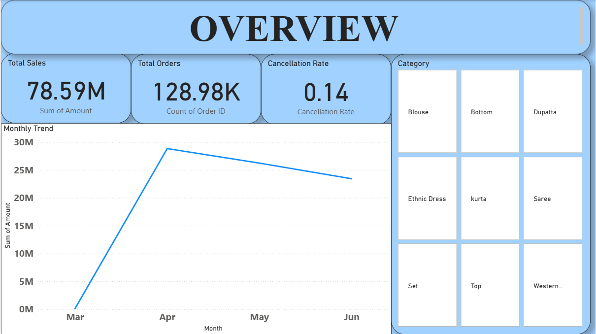
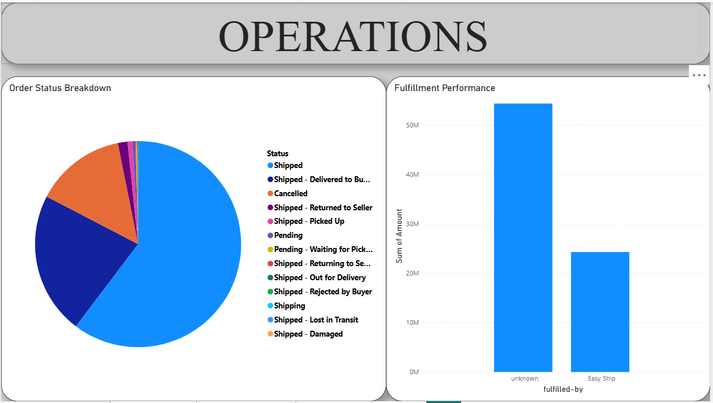
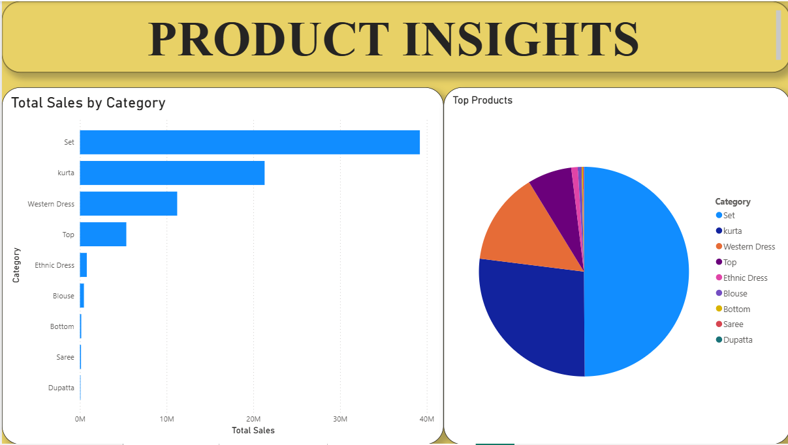

# Amazon Sales & Operations Analysis

**Excel · SQL exploration · Python exploration · Power BI**

Sales totals only tell part of the story. I wanted to see what happens *after* an online order is placed. This project looks at sales, cancellations, fulfillment and product performance using a dataset of more than **128,000 e-commerce order records**.

The main question was: **How can order-level reporting help a team spot sales concentration and potential operational problems?**

## Dashboard preview

## What I looked at

**Sales performance:** Overall sales, order trends and category contribution. A small group of categories and products appears to account for a large share of sales in the analysis.

**Order outcomes:** Delivered, cancelled and returned orders. I looked at cancellation patterns as a starting point for identifying where the order journey might need attention.

**Fulfillment:** Differences across fulfillment methods and how they relate to order outcomes.

These patterns are useful for raising questions, but they don't establish why an order was cancelled or prove that a fulfillment method caused a better result.

## What I'd recommend investigating

- **Cancellations:** Break them down by category, fulfillment method and period; then check the actual cancellation reasons before proposing fixes.
- **Product concentration:** Compare top-selling products with margins, returns and stock availability rather than prioritizing revenue alone.
- **Fulfillment:** Track delivered-order rate and cancellation rate by method, while accounting for differences in the orders each method handles.

For a real operations team, I'd follow these with metrics such as **on-time delivery, return rate, net sales after returns and cost per fulfilled order**.

## Reproduce the operations analysis

The repository also contains a [Python XLSB analysis script](python/analyze_amazon.py), [SQLite queries](sql/operations_analysis.sql) and [setup notes](docs/REPRODUCE.md). The script can generate order-status, category and fulfillment summaries from the supplied workbook. **It still needs to be run and checked against the workbook**; generated analysis outputs are not included yet.

## Tools and project files

| File | Purpose |
|---|---|
| [Excel workbook](data/Amazon%20Sale%20Report.xlsb) | Order-level data and analysis |
| [Power BI report](powerbi/Amazon%20Sale%20Report.pbix) | Dashboard |
| [Power BI screenshots](assets/PowerBI.png) | Report preview |
| [SQL work screenshots](assets/MYSQL.png) | SQL exploration evidence |
| [Python/Colab screenshot](assets/python-GoogleCollab.png) | Python exploration evidence |

The original SQL and Python work is shown in screenshots. The reproducible Python script and SQL queries are separate from the original screenshots. Their results still need to be checked against the workbook.

## What this project demonstrates

For me, the important part is connecting order data to questions an operations or commercial team would care about: what sells, what doesn't complete successfully, and where deeper investigation could help.

This is a portfolio analysis. No real-world cost savings, conversion improvement or operational change is claimed.

---

[Ahmed Fazil](https://github.com/AhmedFazil007)
